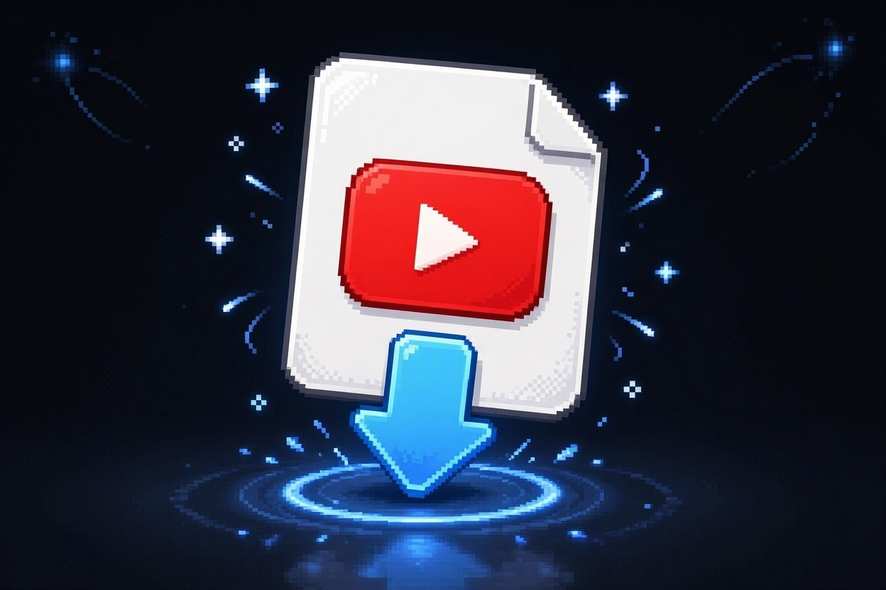

# Baixador de YouTube

   

Aplicativo de desktop com interface gráfica para baixar vídeos em **MP4** ou áudios em **MP3** do YouTube, sempre na maior qualidade disponível. 

## Recursos

- **Interface gráfica** simples, sem precisar usar o terminal para baixar.
- **Qualidade máxima**: o vídeo usa a melhor resolução disponível (até 4K/8K, quando existir) e o MP3 sai a 320 kbps.
- **Download de playlists** inteiras, com subpasta própria e arquivos numerados.
- **Botão Cancelar** para interromper o download a qualquer momento.
- **Barra de progresso** com porcentagem, velocidade, tempo restante e posição na playlist (ex.: `[3/20]`).
- **Modo compatibilidade** (H.264, até 1080p) para vídeos que precisam tocar em qualquer player.
- Os arquivos são salvos **na mesma pasta do programa**.
- A janela não trava durante o download.

## Requisitos

- **Python 3.9 ou superior**
- **yt-dlp**
- **ffmpeg** instalado e disponível no PATH (necessário para converter MP3 e juntar vídeo e áudio em alta qualidade)
- `tkinter` (já vem com o Python no Windows e no macOS)

## Como usar
1. Cole o link do YouTube (botão **Colar** ou Ctrl+V).
2. Escolha o formato:
   - **MP4**: vídeo na qualidade máxima.
   - **MP3**: áudio a 320 kbps.
3. Clique em **Baixar** (ou aperte Enter).
4. Para parar, clique em **Cancelar**.
5. Use **Abrir pasta** para ver os arquivos baixados.

### Qualidade e compatibilidade

Por padrão, o MP4 usa a maior resolução disponível, que muitas vezes é VP9 ou AV1. Esses codecs podem não abrir no Windows Media Player ou no player de filmes e séries do Windows. O **VLC** toca sem problemas.

Se o vídeo não abrir no seu player, marque **"Priorizar compatibilidade (H.264, máx. 1080p)"**. Ele toca em qualquer lugar, mas fica limitado a 1080p.

O MP3 sai a 320 kbps, o máximo do formato. Como o áudio original do YouTube já tem qualidade limitada, o arquivo não fica melhor do que a fonte.

## Aviso legal

Use esta ferramenta apenas para baixar conteúdo que você tem permissão para baixar (como seus próprios vídeos, conteúdo com licença livre ou de domínio público). Os termos de uso do YouTube restringem o download de vídeos de terceiros, e o respeito aos direitos autorais é responsabilidade de quem usa o programa.
